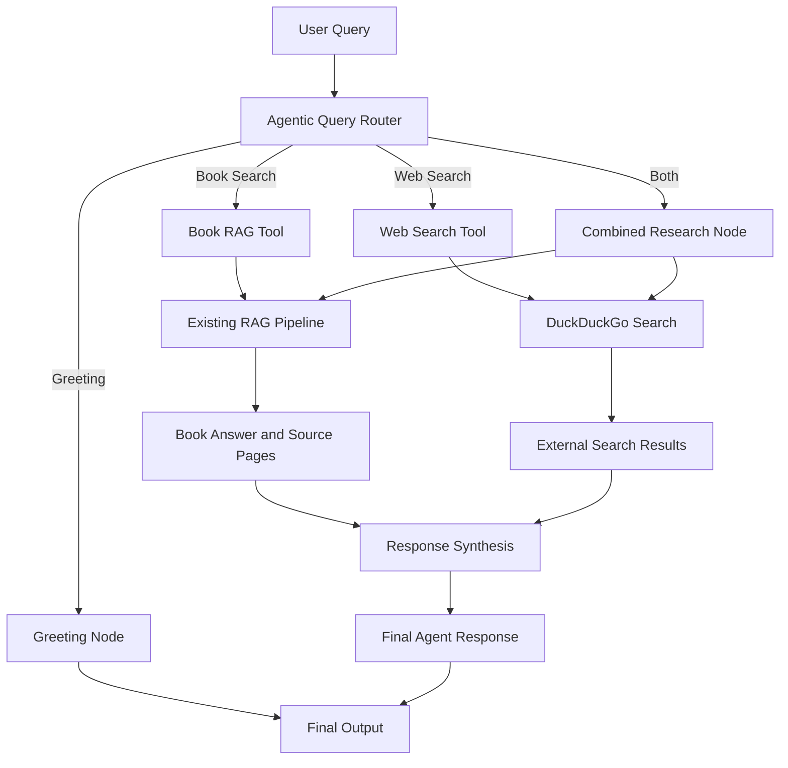
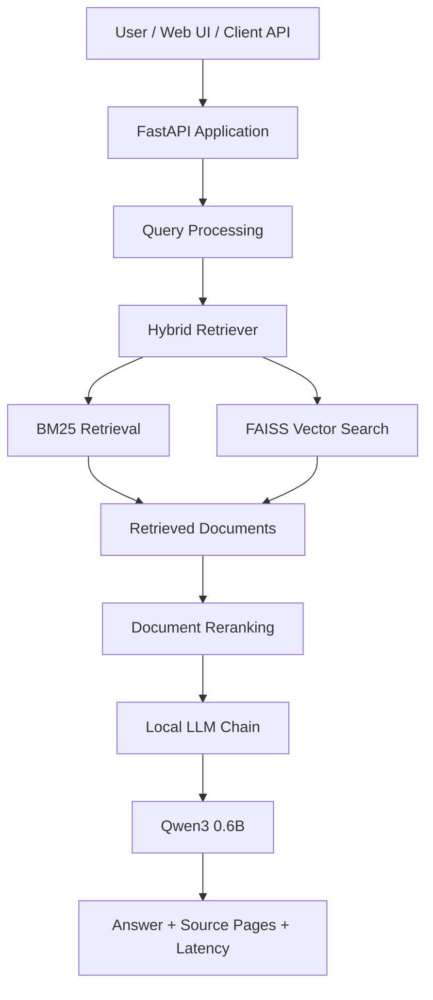

# Agentic AI Research Assistant

**An intelligent, tool-using AI research assistant combining Retrieval-Augmented Generation (RAG), hybrid search, web research, and LLM-powered orchestration.**

Built using **Python, LangChain, LangGraph, FastAPI, FAISS, BM25, Ollama, and DuckDuckGo Search**.

The project extends a technical book-based RAG application into an agentic AI system capable of understanding user queries, selecting appropriate tools, retrieving relevant information, and synthesizing research into structured responses.

Its primary knowledge source is *Hands-On Machine Learning with Scikit-Learn, Keras, and TensorFlow* by Aurélien Géron, supplemented by external web search for information that requires current research.

---

## Table of Contents

- [Overview](#overview)
- [Key Features](#key-features)
- [Technology Stack](#technology-stack)
- [System Architecture](#system-architecture)
- [Agentic Workflow](#agentic-workflow)
- [Existing RAG Pipeline](#existing-rag-pipeline)
- [Project Structure](#project-structure)
- [Installation and Setup](#installation-and-setup)
- [Running the Application](#running-the-application)
- [API Documentation](#api-documentation)
- [Agent Implementation](#agent-implementation)
- [Testing and Validation](#testing-and-validation)
- [Current Limitations](#current-limitations)
- [Future Roadmap](#future-roadmap)

---

## Overview

Traditional RAG applications retrieve information from a predefined knowledge base and use an LLM to generate responses. However, a static knowledge base cannot independently provide information about recent developments, emerging technologies, or current industry practices.

This project addresses that limitation by introducing an **agentic orchestration layer** over an existing Book RAG application.

The system uses LangGraph to determine how each query should be handled.

Depending on the query, the assistant can:

1. Handle greetings and simple conversations directly.
2. Retrieve information from the technical book using the existing RAG pipeline.
3. Search the web for recent AI/ML developments.
4. Combine book-based knowledge and web research to generate a comprehensive answer.

The system also includes a FastAPI-based interface for the existing Book RAG application, providing REST API endpoints and an interactive web dashboard.

### Project Objectives

- Extend a conventional RAG application into a tool-using agentic system.
- Combine semantic and keyword-based information retrieval.
- Enable access to both static knowledge and external information.
- Preserve source page references for book-based answers.
- Use local LLM inference through Ollama.
- Maintain a modular architecture that supports additional tools and capabilities.

---

## Key Features

### 1. Agentic Query Routing

A LangGraph-based router determines which execution path is appropriate for an incoming query.

Four routes are currently implemented:

| Route | Function |
|---|---|
| `greeting` | Handles greetings and simple conversations without research. |
| `book_search` | Uses the existing Book RAG pipeline to answer questions. |
| `web_search` | Retrieves external information using DuckDuckGo Search. |
| `both` | Invokes both research tools and synthesizes their results. |

The routing mechanism combines rule-based greeting detection with LLM-based query classification.

### 2. Hybrid RAG Retrieval

The existing Book RAG pipeline combines:

- FAISS vector similarity search.
- BM25 keyword-based retrieval.
- Hybrid retrieval.
- Document reranking.

This combination supports both semantic and lexical matching, improving the retrieval of technical concepts and definitions.

### 3. Web Research Integration

A DuckDuckGo-based search tool enables the assistant to retrieve external information.

It is intended for queries involving:

- Recent AI/ML developments.
- Emerging AI technologies.
- New frameworks and tools.
- Industry practices and trends.
- Information not covered by the technical book.

### 4. Combined Research and Synthesis

The `both` route retrieves information from the book and the web.

The synthesis node receives the research results and generates a consolidated response using the local LLM.

This allows the assistant to connect theoretical machine learning concepts with contemporary industry developments.

### 5. Local LLM Inference

The application uses Ollama for local language model inference.

| Model | Purpose |
|---|---|
| `qwen3:0.6b` | Query routing and response synthesis |
| `nomic-embed-text` | Document embeddings and vector retrieval |

Local inference reduces dependence on externally hosted LLM APIs for these operations.

### 6. FastAPI Deployment

The existing Book RAG application provides a FastAPI-based REST API with:

- Interactive web interface.
- Pydantic request validation.
- CORS middleware.
- Health monitoring.
- Query endpoints.
- Automatically generated API documentation.

### 7. Source Attribution

The Book RAG pipeline extracts source page references from retrieved documents.

This allows users to trace book-based responses back to the original technical material.

---

## Technology Stack

| Technology | Application |
|---|---|
| Python 3.11 | Core development |
| LangChain | LLM and tool integration |
| LangGraph | Agent orchestration |
| FastAPI | REST API deployment |
| Uvicorn | ASGI server |
| Pydantic | Request validation |
| Ollama | Local LLM inference |
| Qwen3 0.6B | Routing and synthesis |
| FAISS | Vector similarity search |
| BM25 | Keyword retrieval |
| Sentence Transformers | Embedding and retrieval components |
| Hugging Face Transformers | Reranking infrastructure |
| PyTorch | Model inference |
| DuckDuckGo Search | External web research |

---

## System Architecture

The project consists of two related layers:

1. **Book RAG Application:** The existing document retrieval and question-answering system, exposed through FastAPI.
2. **Agentic Orchestration Layer:** A LangGraph workflow that selects and invokes research tools.

### High-Level Architecture



### Existing Book RAG Architecture

The underlying RAG application follows this retrieval and generation workflow:



The existing RAG pipeline is exposed to the agent through a callable tool. The agent does not need to duplicate the ingestion, retrieval, or reranking implementation.

---

## Agentic Workflow

The agent is implemented using LangGraph's `StateGraph`.

### 1. Query Processing

Every incoming query is passed to the routing node.

Before invoking the LLM, the system checks whether the input matches a predefined greeting.

If the input is a greeting, the agent directly invokes the greeting node.

Otherwise, the query is passed to the routing LLM.

### 2. LLM-Based Routing

The router uses a dedicated prompt to classify the query into one of four routes.

The supported route identifiers are:

```python
book_search
web_search
both
greeting
```

The LLM response is normalized to ensure consistency with the route names expected by LangGraph.

### 3. Tool Execution

Based on the routing decision:

**Book Search**

The agent invokes the existing `book_search` tool, which executes the Book RAG pipeline and returns an answer with source page references.

**Web Search**

The agent invokes the `web_search` tool, which retrieves relevant external search results.

**Both**

The agent invokes both tools and passes their outputs to the synthesis node.

**Greeting**

The greeting node generates a direct response without invoking research tools.

### 4. Response Synthesis

The synthesis node uses the original query and the available research results.

It is designed to:

- Generate a structured answer.
- Use the retrieved research results.
- Avoid inventing unsupported citations.
- Combine book and web information when both are available.
- Communicate when the available information is insufficient.

### 5. Final Output

The agent exposes a consistent response structure:

```python
{
    "query": "...",
    "route": "...",
    "answer": "...",
    "sources": [],
    "latency": 0.0,
    "routing_reason": "..."
}
```

The `sources` field currently represents book page references. Web source attribution is an area for further development.

---

## Existing RAG Pipeline

The agent builds upon a previously developed Book RAG application.

### Document Ingestion

The knowledge base is created from:

*Hands-On Machine Learning with Scikit-Learn, Keras, and TensorFlow.*

The ingestion pipeline includes:

1. PDF loading using PyPDFLoader.
2. Text preprocessing and cleaning.
3. Removal of unnecessary page and formatting artifacts.
4. Recursive text splitting.
5. Embedding generation.
6. FAISS vector index creation.

### Embedding Model

`nomic-embed-text` is used to generate document embeddings.

### Hybrid Retrieval

The retrieval system combines two approaches:

**BM25**

Performs lexical retrieval based on keyword relevance.

**FAISS**

Performs semantic retrieval using vector similarity.

Combining these methods helps retrieve documents that are relevant both contextually and through exact technical terminology.

### Reranking

Retrieved documents are passed through a reranking component to improve their relevance before being supplied to the generation model.

### Generation

The retrieved context is passed to the local Qwen3 model through the LangChain pipeline.

The generated answer includes relevant book page references where available.

---

## Project Structure

The following structure represents the major components of the project. Existing ingestion, retrieval, and API filenames should be retained as implemented in the repository.

```text
sample_rag/
│
├── src/
│   │
│   ├── agent/
│   │   ├── __init__.py
│   │   ├── state.py
│   │   ├── prompt.py
│   │   ├── nodes.py
│   │   └── graph.py
│   │
│   ├── tools/
│   │   ├── rag_tool.py
│   │   └── web_search_tool.py
│   │
│   ├── ingestion/
│   │   └── ...
│   │
│   ├── retrieval/
│   │   └── ...
│   │
│   ├── reranking/
│   │   └── ...
│   │
│   ├── vectorstore/
│   │   └── ...
│   │
│   ├── api/
│   │   └── ...
│   │
│   ├── main.py
│   └── test_agent.py
│
├── requirements.txt
├── README.md
└── ...
```

### Agent Directory

| File | Responsibility |
|---|---|
| `state.py` | Defines the shared state schema for the LangGraph workflow. |
| `prompt.py` | Contains the routing and synthesis prompts. |
| `nodes.py` | Implements the router, greeting, book search, web search, combined research, and synthesis nodes. |
| `graph.py` | Constructs and compiles the LangGraph workflow and exposes `ask_agent()`. |

### Tools Directory

| File | Responsibility |
|---|---|
| `rag_tool.py` | Exposes the existing Book RAG pipeline as a callable tool. |
| `web_search_tool.py` | Implements the external DuckDuckGo search tool. |

### Other Components

| Component | Responsibility |
|---|---|
| `ingestion/` | Loads, cleans, splits, and indexes the technical book. |
| `retrieval/` | Implements BM25, FAISS, and hybrid retrieval. |
| `reranking/` | Improves relevance of retrieved documents. |
| `vectorstore/` | Stores the FAISS vector index. |
| `api/` | Contains the FastAPI application components. |
| `main.py` | Provides the existing application entry point. |
| `test_agent.py` | Validates the LangGraph agent workflow. |

---

## Installation and Setup

### Prerequisites

- Python 3.11
- Git
- Ollama
- Required Python dependencies
- Existing RAG vector database

### 1. Clone the Repository

```bash
git clone <YOUR_REPOSITORY_URL>
cd sample_rag
```

### 2. Create a Virtual Environment

```bash
python -m venv .venv
```

Activate it using PowerShell:

```powershell
.\.venv\Scripts\Activate.ps1
```

### 3. Install Dependencies

```bash
pip install -r requirements.txt
```

Ensure that the dependencies required by the existing RAG pipeline and the agent are included.

### 4. Install and Configure Ollama

Install Ollama and download the required models:

```bash
ollama pull qwen3:0.6b
ollama pull nomic-embed-text
```

Ensure the Ollama service is running before starting the application.

### 5. Configure the Environment

For the current Windows development environment, set:

```powershell
$env:USE_TF = "0"
```

This prevents unnecessary TensorFlow imports when using the PyTorch-based reranking components.

---

## Running the Application

### A. Run the Existing FastAPI RAG Application

From the project root:

```bash
python src/main.py
```

The application runs by default at:

```text
http://127.0.0.1:8000
```

Alternatively, launch it through Uvicorn:

```bash
uvicorn src.api:app --host 127.0.0.1 --port 8000 --reload
```

The existing application also supports:

```bash
python src/main.py --reload
```

For CLI-based RAG testing:

```bash
python src/main.py --cli
```

### B. Run the LangGraph Agent

Navigate to the source directory:

```powershell
cd src
```

Set the environment variable:

```powershell
$env:USE_TF = "0"
```

Run the agent test script:

```powershell
python test_agent.py
```

The test script invokes the compiled graph through the `ask_agent()` interface and displays the selected route, generated answer, source pages, and available latency information.

---

## API Documentation

The existing Book RAG application exposes the following FastAPI endpoints.

### 1. Interactive Web Interface

**Endpoint:** `GET /ui` or `GET /`

Opens the interactive chat dashboard in a modern web browser.

The dashboard includes:

- Query input.
- Sample prompts.
- Answer display.
- Source page badges.
- Latency information.

### 2. Health Check

**Endpoint:** `GET /health`

Checks the status of the application and its primary components.

Example response:

```json
{
    "status": "healthy",
    "vectorstore_loaded": true,
    "llm_model": "qwen3:0.6b",
    "embeddings_model": "nomic-embed-text",
    "version": "1.0.0",
    "timestamp": "2026-08-05T17:38:00Z"
}
```

### 3. Query the RAG Application

**Endpoint:** `POST /api/v1/query`

Alternative endpoint:

`POST /api/v1/chat`

Example request:

```json
{
    "query": "What is supervised learning?",
    "top_k": 5,
    "include_sources": true
}
```

Example response:

```json
{
    "query": "What is supervised learning?",
    "answer": "Supervised learning is a machine learning paradigm...",
    "sources": [36, 37, 380, 579, 777],
    "latency_seconds": 1.42,
    "timestamp": "2026-08-05T17:38:02Z"
}
```

*These endpoints belong to the existing Book RAG application. The LangGraph agent is currently tested through its Python invocation interface; exposing the complete agent through dedicated FastAPI endpoints remains a planned integration.*

### 4. Interactive API Documentation

Once the FastAPI application is running:

| Documentation | URL |
|---|---|
| Swagger UI | `http://127.0.0.1:8000/docs` |
| ReDoc | `http://127.0.0.1:8000/redoc` |

---

## Agent Implementation

### Shared State

The LangGraph workflow uses a shared `TypedDict` state schema.

```python
from typing import Literal, TypedDict

Route = Literal[
    "greeting",
    "book_search",
    "web_search",
    "both"
]

class AgentState(TypedDict, total=False):
    query: str
    route: Route
    book_result: str
    web_result: str
    answer: str
    sources: list[int]
    latency: float
    routing_reason: str
```

This allows different nodes to update and access information throughout the workflow.

### Graph Construction

The graph uses `StateGraph` with conditional routing.

```python
from langgraph.graph import START, END, StateGraph

builder = StateGraph(AgentState)

builder.add_node("router", route_query)
builder.add_node("greeting", greeting_node)
builder.add_node("book_search", book_node)
builder.add_node("web_search", web_node)
builder.add_node("both", both_node)
builder.add_node("synthesis", synthesis_node)

builder.add_edge(START, "router")

builder.add_conditional_edges(
    "router",
    select_route,
    {
        "greeting": "greeting",
        "book_search": "book_search",
        "web_search": "web_search",
        "both": "both"
    }
)

builder.add_edge("greeting", END)
builder.add_edge("book_search", END)
builder.add_edge("web_search", "synthesis")
builder.add_edge("both", "synthesis")

builder.add_edge("synthesis", END)

agent = builder.compile()
```

The explicit graph structure separates the routing decision from the execution of individual tools.

### Agent Invocation

The compiled graph is exposed through a simple function:

```python
def ask_agent(query: str) -> dict:
    result = agent.invoke({"query": query})

    return {
        "query": result.get("query", query),
        "route": result.get("route", "book_search"),
        "answer": result.get("answer", ""),
        "sources": result.get("sources", []),
        "latency": result.get("latency", 0.0),
        "routing_reason": result.get("routing_reason", "")
    }
```

This provides a consistent interface for future API integration.

---

## Testing and Validation

The initial agent implementation has been tested with four representative queries.

### Test Results

| Query | Expected Route | Actual Route | Result |
|---|---|---|---|
| `Hey!` | greeting | greeting | Passed |
| `Define supervised learning.` | book_search | book_search | Passed |
| `What are the latest developments in agentic AI?` | web_search | web_search | Passed |
| `Explain the machine learning concept from the book and compare it with current industry practices.` | both | both | Passed |

### Observed Results

**Greeting route**

Successfully generates a direct response without invoking research tools.

**Book search route**

Successfully retrieves book-based information and returns source page references.

Example source pages:

```text
[36, 37, 380, 749, 777]
```

**Web search route**

Successfully retrieves external information for recent AI/ML-related queries and generates a response using the search results.

**Combined research route**

Successfully invokes both research tools and generates a consolidated response.

One observed combined-query execution returned:

```text
Latency: 7.323 seconds

Sources: [17, 30, 34, 59]
```

These tests validate the basic orchestration and tool integration. They do not yet represent comprehensive benchmarks of retrieval accuracy, routing accuracy, or factual reliability.

---

## Current Limitations

The current implementation is a functional foundation, with several areas identified for improvement.

1. **Web search quality:** Search results need improved relevance, diversity, URL filtering, and source extraction.
2. **Source attribution:** Web citations need to be preserved and clearly distinguished from book page references.
3. **Synthesis reliability:** Responses need stronger grounding in the retrieved research to minimize unsupported claims.
4. **Latency monitoring:** Individual tool execution times and total request latency need consistent measurement.
5. **Routing reliability:** The current small local model can occasionally misclassify ambiguous queries.
6. **Parallel execution:** The combined research route currently invokes the tools sequentially; concurrent execution could reduce latency.
7. **Conversation memory:** Multi-turn contextual conversations have not yet been implemented in the agentic workflow.
8. **Agent API integration:** The LangGraph agent still needs to be exposed through the FastAPI application.

---

## Future Roadmap

| Phase | Enhancement |
|---|---|
| 1 | Improve web search quality and source extraction |
| 2 | Implement source-aware response synthesis |
| 3 | Add parallel execution for combined research |
| 4 | Implement complete latency and execution monitoring |
| 5 | Improve query classification and routing reliability |
| 6 | Introduce conversational memory |
| 7 | Integrate the LangGraph agent with FastAPI |
| 8 | Extend the interactive web interface to support agentic queries |

---

## Design Principles

The project follows a modular and extensible development approach.

**Modularity:** Routing, retrieval, web research, and synthesis are implemented as separate components.

**Reusability:** The existing RAG pipeline is exposed as a tool rather than duplicated inside the agent.

**Local Inference:** Ollama enables local LLM execution.

**Grounded Generation:** Responses are intended to be based on retrieved knowledge and external research.

**Extensibility:** LangGraph makes it possible to introduce additional tools and workflows without redesigning the entire application.

---

## Author

**Kushagra Singh**

B.Tech — Information Technology

Areas of Interest:
- Artificial Intelligence and Machine Learning
- Large Language Models
- Retrieval-Augmented Generation
- Agentic AI
- AI Application Development

---

## Acknowledgements

- Aurélien Géron — *Hands-On Machine Learning with Scikit-Learn, Keras, and TensorFlow*
- LangChain and LangGraph
- Ollama
- FAISS
- Hugging Face
- FastAPI

---

**Project Status:** Core Book RAG application implemented; initial LangGraph agent orchestration and tool integration implemented and tested. Further development is focused on research quality, source attribution, execution efficiency, and complete API integration.
